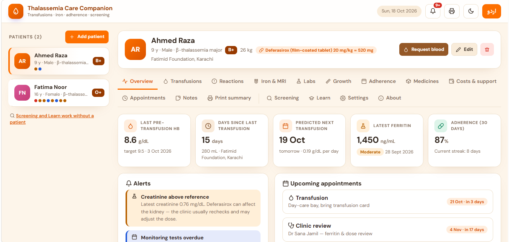

# Thalassemia Care Companion

A web app for tracking thalassemia care: transfusions, iron levels, medicines, lab results and appointments, with English and Urdu interfaces.

**[Live demo](https://rehman1228.github.io/Thalassemia-Care-app/)**

## Features

- **Patient profiles:** manage more than one patient, with blood group, weight, diagnosis and treatment centre
- **Transfusion log:** records past transfusions and predicts the next one
- **Iron and chelation tracking:** ferritin, MRI iron and chelation medicine dose
- **Lab results and growth charts:** monitor trends over time
- **Medicines and adherence:** medicine inventory and a daily adherence calendar
- **Costs and support programmes:** keep track of treatment expenses
- **Appointments, notes and alerts:** reminders for upcoming visits and overdue tests
- **Printable summary:** a clean summary a patient can show their doctor
- **Carrier screening and learning library:** works even without a patient profile
- **English and Urdu interface**

### Added in this version

- Dark mode, with your choice remembered
- Offline indicator (the app keeps working without internet)
- Back-to-top button for long pages
- New orange, cream and white design

## Privacy

All data stays in your own browser. Nothing is uploaded to any server.

## How to run it

1. Download or clone this repository.
2. Keep all the files in the same folder.
3. Open `index.html` in any modern browser.

## Project structure

| File | Purpose |
|------|---------|
| `index.html` | Page structure |
| `style.css` | Design, colors and dark theme |
| `script.js` | App logic |
| `extras.js` | Dark mode, offline indicator and other extras |

## Built with

HTML, CSS and vanilla JavaScript. No frameworks and no build step.

## Credits

Based skills and experience build it.separate files and extended by **Rehman Gul**, with some help from AI.

## Disclaimer

This is an educational project. It does not give medical advice. Always follow your doctor's guidance.

## Contact

Rehman Gul: [GitHub](https://github.com/Rehman1228)
